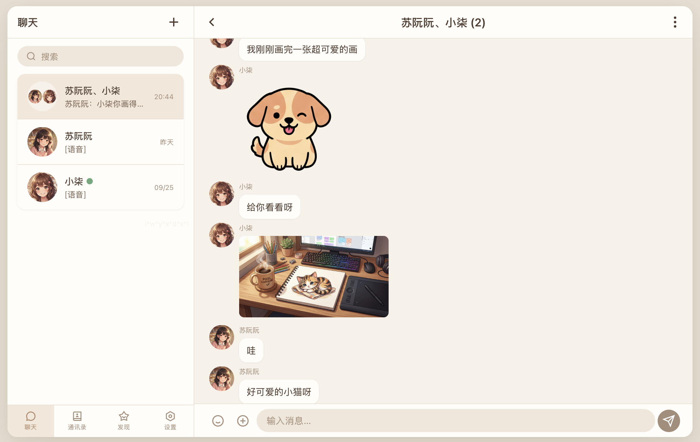

# PawzoChat — 拟人感 · 多功能 · 可扩展的 AI 伙伴引擎

<div align="center">


**拟人感 · 多功能 · 可扩展的 AI 伙伴引擎**

[](https://www.python.org/)
[](LICENSE)
[]()
[]()
[]()
[](https://linux.do/)

</div>

---

## 简介

PawzoChat 是一个功能强大的 AI 对话平台，基于大语言模型（LLM）构建，可通过Openclaw通道接入微信与 QQ 双平台，让 AI 角色真正「走入」你的社交网络。

核心设计理念：**让 AI 不只是工具，而是有性格、有记忆、会主动表达的数字伙伴。**

## 功能特性

### 对话
- **AI 聊天** — 多轮对话上下文、工具调用循环（Tool Call Loop）、多模态理解（图片/文件）
- **自定义人设** — 为每个角色设定独立的系统提示词、世界书（World Book）、温度/模型等参数
- **一键生成人设** — 输入一句话需求，AI 自动撰写完整的人设 Prompt
- **AI 记忆系统** — 角色在对话中自主决定何时记录/更新记忆，超限自动合并；Web 面板可手动管理
- **情绪表情** — 根据对话内容自动检测情绪并插入贴纸/表情包，支持自定义表情库
- **Web 多角色群聊** — 邀请多个 AI 角色同群互动，支持 @成员、@所有人、角色互相接话，以及图片、表情和语音回复；可自定义群内人设、发言节奏与每位成员的群记忆

### 多平台接入
- **微信** — 基于 iLink 协议（长轮询），扫码登录，支持文本/图片/文件/语音消息收发
- **QQ** — 基于 QQ 开放平台 API v2（WebSocket 网关），支持私聊文本/图片/文件/语音/引用消息
- **Web 管理面板** — 内置本地+公网双入口 Web 界面，支持多账号切换、对话预览、人设管理

### 生图/语音
- **AI 生图** — 角色在聊天中可调用 `generate_image` 工具直接生成图片发送给用户；支持 OpenAI Image、Gemini (NanoBanana)、NovelAI 等多种后端，可按角色设置画风前缀和参考图
- **AI 语音（TTS）** — 角色可在回复中用 `[语音]` 标记将文字转为语音消息；支持 MiniMax、MiMo、OpenAI 兼容接口及 PawAPI；在角色编辑的语音页配置语言、音色和发音控制，在「设置 → 语音服务商 → 语音测试」中可调整参数并试听。微信通道以音频文件发送，QQ通道转码为 SILK 原生语音气泡，Web 面板渲染为可播放语音气泡
- **入站语音回放** — 微信/QQ 用户语音会保存为 Web 面板可播放的语音条，聊天窗口中长按或右键可展开/收起平台转写；发送给 AI 的上下文统一为 `[语音] 转写内容`

### 朋友圈
- **社交动态** — 角色与用户共处同一条朋友圈 Feed，可发动态、点赞、评论
- **AI 驱动** — 角色自主决定何时发动态，评论/回复由 LLM 生成，动态可自动配图
- **记忆联动** — 角色发布的动态和评论可选写入记忆，让角色「记住自己说过什么」
- **编辑管理** — Web 面板可编辑/删除动态与评论，自定义发布与评论 Prompt 模板

### 扩展能力
- **MCP 工具** — 支持 Model Context Protocol，可接入联网搜索、图像识别等外部工具
- **插件系统** — 运行时发现和加载第三方插件，支持注册通道、注册工具、复用 LLM、发送消息
- **多模型支持** — OpenAI 兼容、Anthropic、Gemini 三种后端，预设 PawAPI / DeepSeek / SiliconFlow 等常用中转

### Web 管理面板
- **对话管理** — 查看/搜索历史对话、编辑消息、清除对话、多会话切换
- **人设管理** — 创建/编辑/导入/导出角色，头像裁剪、参考图上传、Voice/TTS 配置
- **设置中心** — LLM 服务商与模型管理、语音服务商管理、生图服务商管理、MCP 服务器配置、插件管理、主题换肤
- **公网安全远程访问** — 支持一键启用独立公网 HTTPS 入口，自动生成自签名证书与随机 URL 路径前缀；PBKDF2 密码认证、暴力破解全局锁定、CSRF 同源检查、安全响应头等多层防护；配置后可从手机浏览器安全远程管理面板，详情参见[网络安全指南](docs/network-security.md)

## 界面预览

PawzoChat 提供功能完备的 Web 管理面板，支持桌面端和移动端双布局，集成对话管理、人设管理、AI 朋友圈和系统设置等核心功能。

### 桌面端面板总览

**聊天页面** — 实时对话窗口，支持文本、图片、文件、语音消息收发，左侧展示会话列表，右侧显示角色信息和上下文记忆。

<div align="center">
  
</div>

**通讯录页面** — 管理所有 AI 角色（人设），支持创建、编辑、导入/导出角色卡（兼容 SillyTavern 格式）。

<div align="center">
  
</div>

**朋友圈页面** — 与 AI 角色共享社交动态 Feed，自动同步微信/QQ 联系人头像，支持发动态、点赞、评论及 AI 自主互动。

<div align="center">
  
</div>

**设置页面** — 一站式配置 LLM 服务商（OpenAI / Anthropic / Gemini）、生图/语音服务商、MCP 工具、运行时插件、主题换肤等。

<div align="center">
  
</div>

### 多角色群聊

把喜欢的 AI 角色邀请到同一个群里，一起聊天、分享图片、围绕话题展开讨论。

- **互动接话** — 支持 @成员、@所有人，角色也可互相 @ 邀请对方加入讨论。
- **丰富表达** — 支持发送文字、图片、文件和表情，角色可在聊天中生成图片、发送情绪表情与语音回复。
- **自定义群聊氛围** — 设置共同背景与聊天规则，为每位成员编写群内专属人设，调整回复概率和连续回复上限。
- **各自记住相处点滴** — 每位角色拥有独立的群记忆，可分别查看、编辑和管理。

<div align="center">
  
</div>

### 跨平台同步效果

PawzoChat 自动同步微信和 QQ 平台的聊天内容到 Web 管理面板，呈现统一的对话界面，左侧为原始平台截图，右侧为 PawzoChat 面板同步效果。

<div align="center">

| 平台 | 原始聊天 | PawzoChat 同步展示 |
|:---:|:---:|:---:|
| **微信** <br> 角色「小柒」讨论迪士尼约会 |  |  |
| **QQ** <br> 角色「苏阮阮」语音聊天 |  |  |

</div>

### AI 朋友圈动态

AI 角色可自主发布图文动态，其他角色和用户均可点赞、评论互动。所有动态与记忆系统联动，让角色「记住自己说过什么」。

<div align="center">

| 聊天列表概览 | 朋友圈详情 |
|:---:|:---:|
|  |  |

</div>

## 快速开始

### 环境要求

- **Python 3.10+**
- Windows 10+ 或 macOS 11+
- （可选）微信账号用于扫码登录
- （可选）QQ 开放平台 AppID/AppSecret

### 开发模式运行

**Windows：** 双击 `Run.bat` 或在终端执行：
```bash
Run.bat
```

**macOS：** 双击 `Run.command` 或在终端执行：
```bash
chmod +x Run.command && ./Run.command
```

脚本会自动：
1. 检测 Python 环境（不存在则提示安装）
2. 创建虚拟环境 `.venv`（如不存在）
3. 安装项目依赖（自动选择可用 pip 镜像源）
4. 启动 PawzoChat 主程序

首次启动后，浏览器会自动打开 Web 管理面板（默认 `http://127.0.0.1:62000`）。按照「快速配置」向导，依次完成语言模型配置、联系人创建、人设预览和隐私设置，即可开始使用。

### 手动运行

```bash
python -m venv .venv
source .venv/bin/activate        # macOS/Linux
# .venv\Scripts\activate         # Windows
pip install -r requirements.txt
python main.py
```

### 构建可执行文件

**Windows：** 双击 `BuildForWin.bat`，进入交互式菜单：
- 构建主程序（PyInstaller + PawzoChat.spec）
- 构建 MCP 服务器（--onefile 独立可执行文件）
- 打包 Release zip（含 data/ 资源同步）

**macOS：** 双击 `BuildForMac.command`，菜单同上。

构建产物输出到 `dist/PawzoChat/`，Release zip 输出到 `dist/release/`。

## 项目架构

```
PawzoChat/
├── main.py                  # 应用入口
├── Run.bat / Run.command    # 开发模式启动脚本
├── BuildForWin.bat          # Windows PyInstaller 构建
├── BuildForMac.command      # macOS PyInstaller 构建
├── requirements.txt         # Python 依赖
├── PawzoChat.spec           # PyInstaller spec
├── pawzochat/               # 核心 Python 包
│   ├── app.py               # 应用生命周期与模块编排
│   ├── core/                # 配置管理、插件管理器、扩展机制
│   ├── llm/                 # LLM Provider 抽象与多后端实现
│   ├── mcp/                 # MCP 协议支持（连接管理、工具聚合、适配器）
│   ├── image/               # 图像生成（OpenAI/Gemini/NovelAI 后端）
│   ├── voice/               # TTS 语音合成（MiniMax/MiMo/ElevenLabs/OpenAI + 转码）
│   ├── services/            # 对话/队列/记忆/表情/朋友圈核心服务
│   ├── channels/            # 通道抽象（微信/QQ/Web/插件）
│   ├── transport/           # iLink 协议客户端、QQ 网关、CDN 媒体
│   ├── store/               # 会话/消息/朋友圈数据持久化
│   ├── web/                 # Flask Web 面板 + Vanilla JS SPA
│   └── utils/               # 工具函数
├── data/                    # 运行时数据目录
│   ├── config/config.yaml   # 主配置
│   ├── auth/                # 登录凭证
│   ├── chats/               # 对话历史、记忆、图片、文件
│   ├── prompts/             # 人设系统提示词
│   ├── emoji/               # 表情包
│   ├── moments/             # 朋友圈数据
│   ├── plugins/             # 运行时插件
│   ├── mcp_servers/         # MCP 服务器本地部署
│   └── theme/               # CSS 主题
└── docs/                    # 项目文档
    ├── PawzoChat_Architecture.md
    ├── CHANGELOG.md
    ├── plugin-development-guide.md
    ├── plugins-overview.md
    ├── custom-theme-guide.md
    └── network-security.md
```

### 消息处理流程

```
入站消息（微信/QQ/Web）
    → Channel.handle_incoming()
    → MessageQueue.accept_message()
    → 时间窗口聚合
    → ChatService.process_round()
        → 构建上下文（系统提示词 + 记忆 + 世界书 + 历史消息）
        → LLM 推理 + Tool Call 循环
        → 可选：Emoji 表情检测
    → ReplyDispatcher.deliver_messages()
        → 持久化对话
        → 按通道投递（微信/QQ/Web SSE）
        → 触发插件 Hooks
```

## 配置

主配置文件位于 `data/config/config.yaml`，核心配置段：

| 配置段 | 说明 |
|--------|------|
| `llm_providers` | LLM 服务商与模型列表 |
| `image_providers` | 生图服务商（OpenAI/Gemini/NovelAI） |
| `voice_providers` | TTS 语音服务商（MiniMax/MiMo/ElevenLabs/OpenAI） |
| `personas` | 角色列表（绑定模型、提示词、记忆/生图/语音开关） |
| `mcp_servers` | MCP 工具服务器配置 |
| `capability_adapters` | 能力适配器（如 `recognize_image`） |
| `chat` | 对话参数（队列等待、上下文窗口、工具策略） |
| `reply` | 回复参数（打字延迟、记忆提醒轮数） |
| `moments` | 朋友圈设置（发布者/评论者/概率/Prompt 模板） |
| `web` | Web 面板设置（本地端口、公网前缀、HTTPS） |

大部分配置可通过 Web 管理面板的「设置」页面直接修改，无需手动编辑 YAML。

## 支持的模型

通过 LLM Provider 抽象层，PawzoChat 支持任意 OpenAI 兼容接口：

- **PawAPI**（内置预设，推荐）— `paw.v1chat.cc`
- **DeepSeek**（内置预设）
- **SiliconFlow**（内置预设）
- **OpenAI** — `api.openai.com`
- **Anthropic** — 原生 Messages API
- **Google Gemini** — 原生 genai SDK
- **自定义** — 填写任意 OpenAI 兼容 Base URL + API Key

生图后端：OpenAI Image / NanoBanana (Gemini) / NovelAI
语音后端：MiniMax 原生 / MiMo 原生 / ElevenLabs 原生（Eleven v4）/ OpenAI 兼容 TTS

## 文档

- [架构文档](docs/PawzoChat_Architecture.md) — 系统分层、核心流程、关键模块说明
- [更新日志](docs/CHANGELOG.md) — 完整的版本变更记录
- [插件开发指南](docs/plugin-development-guide.md) — 插件协议、Hooks、API 参考
- [插件概览](docs/plugins-overview.md) — 内置与社区插件介绍
- [自定义主题指南](docs/custom-theme-guide.md) — CSS 主题编写与导入
- [网络安全指南](docs/network-security.md) — 公网部署的安全注意事项

## 贡献指南

欢迎任何形式的贡献 —— Bug 报告、功能建议、代码提交、文档改进，我们都非常感激。

### 💡 提 Issue

- **Bug 报告** — 请尽可能描述复现步骤、预期行为和实际表现，建议附上相关日志（`data/logs/`）或截图。
- **功能建议** — 说明使用场景和期望效果，我们乐于讨论可行性。

### 🔧 提交 PR

1. Fork 本仓库，在 `main` 分支创建新分支进行开发。
2. 遵循项目现有代码风格和命名约定。
3. 提交前请确保代码能正常运行（参考快速开始章节）。
4. PR 描述中说明改动动机和实现思路。

### 📋 注意事项

- **项目语言** — UI 文本、日志输出、配置标签均使用中文；代码标识符和注释使用英文。
- **代码风格** — Web 前端为无构建步骤的 Vanilla JS，编辑 `pawzochat/web/static/` 下的文件；后端保持现有的模块分层和导入风格。
- **开放式建议** — 部分功能为作者个人需求而设计，并非所有 PR 或建议都会被合并。如果改动较大，建议先提 Issue 讨论方向。
- **安全报告** — 涉及安全的问题请直接联系作者私下报告，不要公开发布漏洞细节。
- **许可** — 提交代码即视为同意以 [AGPL v3](#开源协议) 许可发布。

## 联系我们

<div align="center">

| 渠道 | 联系方式 |
|:---:|:---:|
| 🐧 **QQ 交流群** | **1094834445**（遇到问题优先加群） |
| 👤 **作者 QQ** | 2025128651 |
| 📧 **邮箱** | iwyxdxl@qq.com |
| 📧 **备用邮箱** | iwyxdxl@gmail.com |


</div>

## 开源协议

PawzoChat 采用 **[GNU Affero General Public License v3 (AGPL v3)](LICENSE)** 开源。

AGPL v3 的核心要求：如果你对 PawzoChat 做了修改并将其再次分发或作为网络服务运行，你必须公开修改后的源代码。这确保了软件自由可以惠及所有用户，包括通过网络使用服务的用户。

## 致谢

PawzoChat 的诞生离不开以下开源项目的启发与支持：

- [SillyTavern](https://github.com/SillyTavern/SillyTavern) — 角色卡与世界书架构参考，用于兼容SillyTavern角色卡与世界书的导入
- [OpenClaw WeChat](https://github.com/Tencent/openclaw-weixin) — 微信 iLink 通道参考实现
- [OpenClaw QQ Bot](https://github.com/tencent-connect/openclaw-qqbot) — QQ 开放平台通道参考实现
- [Model Context Protocol (MCP)](https://modelcontextprotocol.io/) — 工具扩展协议
- 以及所有依赖的开源库作者们
